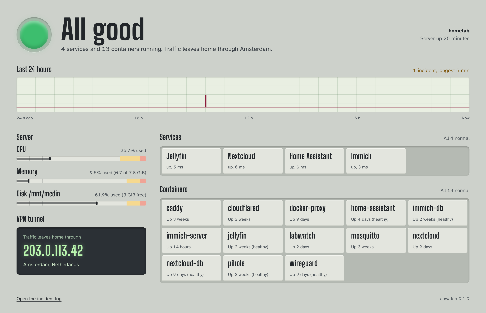
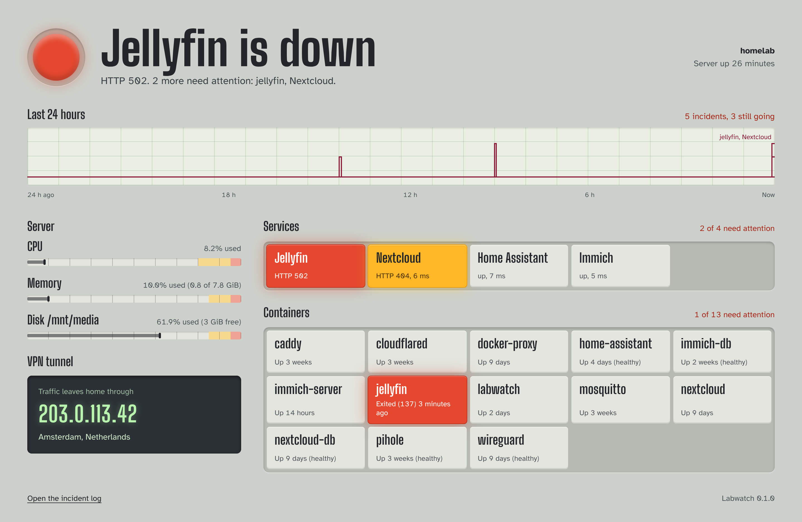
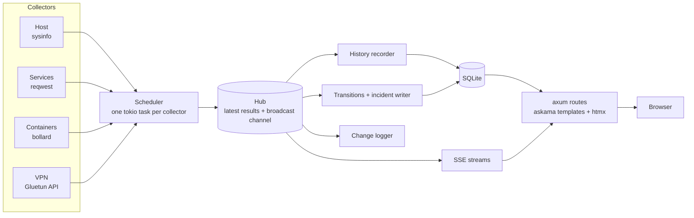

# Labwatch

A self-hosted status board for a home media server, written in Rust.

Labwatch watches the machine, its services, its Docker containers and its VPN tunnel, and shows them on one live page styled like a control-room annunciator panel: windows stay dark while things are fine and light up amber or red when they aren't. When something breaks it records an incident, draws it on a 24-hour chart and changes the browser tab's icon, so a background tab tells you too.

| All good | Something's wrong |
| --- | --- |
|  |  |

It's one 12.5 MB binary (stripped release build) that uses about 13 MB of memory while serving a live dashboard.

## What it does

- **Server meters:** CPU, memory, temperature and disk use, with the warning and critical thresholds engraved on each meter's scale.
- **Service checks:** HTTP checks with response times. A 5xx is critical; a 4xx or a response slower than one second is a warning.
- **Containers:** the state of every Docker container, read through a read-only socket proxy. Exited or unhealthy containers are critical.
- **VPN tunnel:** the public IP leaving the house through Gluetun, compared against the expected exit IP.
- **Incident log:** every time a check breaks and recovers, with how long it lasted, kept for 90 days. A check has to stay bad for two runs in a row before it counts, so one slow response isn't an incident.
- **Live updates:** the page updates over Server-Sent Events, with no polling and no reloads.
- **Plain-language status:** the headline names the worst problem ("Jellyfin is down") and the line under it lists the rest.
- **Status-coloured tab icon:** green, amber or red, with the tab title naming the problem.
- **History:** every reading is stored in SQLite for 24 hours, with hourly averages kept for 30 days and served as JSON for charts.

## Architecture

Labwatch is a Cargo workspace with two crates. `labwatch-core` does all the work: collectors, scheduling, shared state, change detection and storage. `labwatch-server` is the binary: the web server, the HTML views and the command line.



**Collectors** implement one trait, `Collector`, with an async `collect()` that returns a list of checks, each with a status, a human-readable detail and an optional number for charts. A collector never decides how its result is shown or stored.

**The scheduler** gives each collector its own tokio task and interval (host every 5 seconds, containers every 15, services every 30, VPN every 60). Network collectors set their own request timeouts, and because each runs in its own task, a slow endpoint only delays its own collector.

**The hub** is the centre. It holds the latest result from every collector behind an `Arc<RwLock<…>>` and announces each new result on a `tokio::sync::broadcast` channel. Everything downstream is just another subscriber, so adding a feature (alerts, for example) means adding a subscriber, not changing the collectors.

**Subscribers** each own their own state, so none of them needs a lock:

- the history recorder writes every reading to SQLite and rolls it up hourly;
- the incident writer feeds results through `Transitions`, which remembers each check's last confirmed status and emits a change only once a new status holds for two runs, then opens, escalates and closes incident rows;
- each browser connection gets its own SSE stream that turns results into HTML fragments.

**The web layer** is server-rendered. askama compiles the templates into the binary at build time, and htmx swaps the live fragments into the page, so the whole frontend is a stylesheet and a few lines of script.

### Design decisions

- **htmx and askama instead of a WASM frontend.** The goal was a project that is Rust end to end without a second application to build and ship. Server-rendered fragments over SSE keep all the logic in one place, and the page works with only a few lines of JavaScript.
- **A Docker socket proxy.** Mounting `/var/run/docker.sock` into a web-facing container would hand it root on the host. Labwatch talks to `tecnativa/docker-socket-proxy` instead, bound to localhost with only container listing allowed and every write method disabled.
- **Debounced transitions.** Raw status flips are noisy. `Transitions` is a small state machine, fully unit tested, that both the incident log and the logger use, so they always agree on when something broke.
- **Interrupted incidents.** If Labwatch restarts while an incident is open, it can't know whether the check recovered in the meantime, so it closes the incident as interrupted. If the check is still broken, a fresh incident opens.
- **A fingerprinted stylesheet URL.** Pages link `/static/app.css?v=<hash of its contents>`. Cloudflare and browsers can then cache it for a year, and a changed stylesheet always arrives under a new URL.
- **Compile-time SQL checks.** Every query uses sqlx's `query!` macro, which checks it against the schema at build time. The saved query metadata in `.sqlx/` lets CI build without a database.

## Tech stack

| Area | Crates and tools |
| --- | --- |
| Async runtime | tokio, tokio-stream, tokio-util |
| Web server | axum, Server-Sent Events |
| HTML | askama templates, htmx with its SSE extension |
| Storage | sqlx with SQLite, embedded migrations |
| Collectors | sysinfo, reqwest, bollard |
| Command line and config | clap, serde, toml |
| Errors | anyhow |
| Build and deploy | multi-stage Dockerfile with cargo-chef, Docker Compose, GitHub Actions |

## Project layout

```
labwatch/
├── crates/
│   ├── core/                   labwatch-core: everything except the web
│   │   ├── migrations/         SQLite schema, applied at startup
│   │   └── src/
│   │       ├── collectors/     host, services, docker, vpn
│   │       ├── config.rs       config.toml loading
│   │       ├── history.rs      samples, hourly rollups, chart series
│   │       ├── hub.rs          shared latest results + broadcast channel
│   │       ├── incidents.rs    the incident log
│   │       ├── scheduler.rs    one task per collector
│   │       ├── status.rs       Status, Check and Section types
│   │       └── transitions.rs  debounced status-change detection
│   └── server/                 labwatch-server: the binary
│       ├── src/
│       │   ├── main.rs         CLI, routes, background tasks
│       │   ├── dashboard.rs    the board, live updates, tab icon
│       │   └── timeline.rs     the 24-hour strip and the incident log page
│       ├── static/app.css
│       └── templates/
├── .sqlx/                      saved query metadata for offline builds
├── config.example.toml
└── Dockerfile
```

## Getting started

You need a recent stable Rust toolchain (the workspace uses the 2024 edition).

```bash
git clone https://github.com/jburgoy03/labwatch.git
cd labwatch
cp config.example.toml config.toml   # then edit it for your machines
```

Take a one-off reading and print it as a table, or as JSON with `--json`:

```bash
cargo run -- snapshot
```

Run the dashboard, then open http://127.0.0.1:3000:

```bash
cargo run -- serve
```

Both commands read `config.toml` from the current directory; pass `--config <path>` to use another file. The database is created on first run.

## Configuration

Every section is optional except the services you want checked. `config.toml` is gitignored, so real addresses and keys stay out of the repo.

```toml
[server]
bind = "0.0.0.0:3000"            # default 127.0.0.1:3000

[storage]
path = "/data/labwatch.db"       # default labwatch.db

[host]
mounts = ["/", "/mnt/media"]     # disks to check; default ["/"]

[intervals]                      # seconds between runs; these are the defaults
host_secs = 5
services_secs = 30
docker_secs = 15
vpn_secs = 60

[docker]                         # leave out to skip containers
url = "http://127.0.0.1:2375"    # the socket proxy

[vpn]                            # leave out to skip the VPN check
gluetun_url = "http://127.0.0.1:8000"
expected_ip = "203.0.113.7"      # optional; a different exit IP is a warning
api_key = "your-gluetun-api-key" # optional

[[services]]                     # one block per service
name = "Jellyfin"
url = "http://127.0.0.1:8096/health"
timeout_secs = 10                # optional; default 5
```

Unknown keys are rejected at startup, so a typo is an error instead of a silently ignored setting.

## Deployment

The `Dockerfile` is a multi-stage build: cargo-chef caches the dependency layer, so a code-only change rebuilds in a fraction of the time, and the final image is Debian slim with just the binary.

A Compose file that runs Labwatch next to the socket proxy:

```yaml
services:
  docker-proxy:
    image: tecnativa/docker-socket-proxy
    restart: unless-stopped
    environment:
      - CONTAINERS=1   # allow listing containers
      - POST=0         # and nothing else
    volumes:
      - /var/run/docker.sock:/var/run/docker.sock:ro
    ports:
      - 127.0.0.1:2375:2375

  labwatch:
    build: ./src                 # this repository
    restart: unless-stopped
    network_mode: host           # reach the proxy and services on 127.0.0.1
    depends_on:
      - docker-proxy
    volumes:
      - ./config:/config:ro
      - ./data:/data             # the SQLite database survives rebuilds
      # rslave: if the drive drops off the host, the container sees it too,
      # instead of a stale mount that still looks fine.
      - /mnt/media:/mnt/media:rslave
```

To update a running deployment, pull and rebuild:

```bash
git -C src pull && docker compose up -d --build labwatch
```

To reach it from outside the house, the author's setup publishes it through an existing Cloudflare Tunnel, with Cloudflare Access (email one-time PIN) in front so only approved addresses get in. The dashboard has no login of its own, so don't expose it without something like that in front.

## HTTP API

| Route | Returns |
| --- | --- |
| `GET /` | The board |
| `GET /incidents` | The incident log for the last 30 days |
| `GET /events` | Server-Sent Events of HTML fragments, used by the board |
| `GET /api/status` | The latest result from every collector, as JSON |
| `GET /api/history?collector=host&check=CPU&range=24h` | Chart points: raw samples for `24h`, hourly averages for `7d` |
| `GET /api/events` | Server-Sent Events of results as JSON, for other clients |
| `GET /favicon.svg?status=ok` | The tab icon in `ok`, `warning`, `critical` or neutral grey |

## Testing and CI

```bash
cargo test --workspace
cargo clippy --workspace --all-targets -- -D warnings
cargo fmt --all --check
```

GitHub Actions runs all three on every push. CI has no database, so it sets `SQLX_OFFLINE=true` and sqlx checks the queries against the saved metadata in `.sqlx/`. After changing any SQL, regenerate it with `cargo sqlx prepare --workspace` and commit the result, or CI fails.

The tests cover config parsing, status grading, the transition state machine, incident open, escalate and close behaviour, history rollups, and the formatting behind every line of text on the board.

## Roadmap

Planned next: integrations that know more about the house (qBittorrent speeds and ratio, Jellyfin now playing, Sonarr and Radarr health, a disk-full forecast), phone alerts through ntfy, and a wall mode for a spare tablet or TV.
